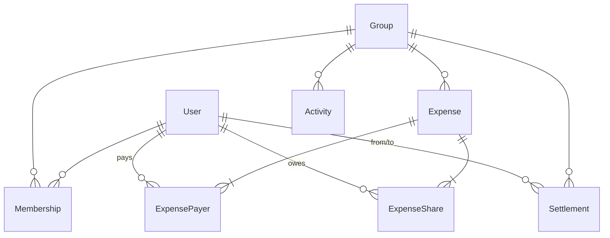

# Esplitiguais — Plan de implementación

App web para repartir gastos entre amigos, estilo Splitwise. Uso privado: 8 personas, usuarios administrados a mano por el dueño.

## Decisiones tomadas

| Tema | Decisión |
|---|---|
| Stack | Django (Python 3.12) + SQLite + plantillas de Django + HTMX + Alpine.js (CDN, sin build de JS) |
| Servidor de aplicación | gunicorn + whitenoise para archivos estáticos |
| Base de datos | SQLite en volumen Docker (`./data`) |
| Usuarios | Los crea el administrador por comando o desde `/admin`. Sin registro público, sin invitaciones, sin email |
| Recuperación de contraseña | Manual por el administrador (`resetear_password`) |
| Moneda | Pesos argentinos (ARS), fija, sin selector de moneda |
| Pagadores | Un gasto puede tener uno o varios pagadores |
| Alojamiento | VPS con Docker Compose |
| Exposición a internet | **Pendiente.** Opción recomendada: Cloudflare Tunnel con `gastos.practicomercio.com.ar` (ver [Despliegue](#despliegue)) |
| PWA | Sí, hecha a mano (manifest + service worker), sin carga de gastos offline. Notificaciones Web Push (VAPID + `pywebpush`) para gastos nuevos o editados y pagos registrados |

### Por qué Django

Lo que más código ocupa (formulario de gasto con varios pagadores y cuatro tipos de reparto, lógica de saldos) cuesta lo mismo en cualquier framework. Django aporta sin escribir código: login, sesiones, hashing de contraseñas, CSRF, migraciones y el panel `/admin`, que cubre la gestión manual de usuarios. Rails o Laravel quedarían casi empatados; Next.js o PocketBase requieren más código propio (auth/admin o interfaz aparte).

## Funcionalidades

### MVP

1. Login / logout y cambio de contraseña propio.
2. Grupos: cualquier usuario crea un grupo y agrega miembros eligiéndolos entre los usuarios existentes.
3. Gastos: descripción, importe, fecha, categoría, pagadores y reparto.
   - Pagadores: "Pagó una persona" (por defecto) o "Pagaron varios" con importe por persona.
   - Reparto: partes iguales entre participantes elegidos, importes exactos, porcentajes o partes (ej. 2 partes para una pareja).
4. Saldos por grupo: cuánto debe o le deben a cada uno.
5. Simplificación de deudas: lista mínima práctica de transferencias "quién le paga a quién".
6. Liquidaciones: registrar pagos entre miembros ("Juan le pagó $ 40.000 a Ana").
7. Historial de actividad: quién creó, editó o borró qué.
8. Edición y borrado lógico de gastos (`deleted_at`), visible en el historial.
9. PWA instalable en Android e iOS.
10. Estadísticas por grupo (pestaña dentro de Gastos): total gastado, cuánto pagó cada uno frente a lo que le tocaba y gasto por categoría.

### Fase posterior (opcional)

- Foto del ticket.
- Exportar a CSV.
- Gastos recurrentes.

### Fuera de alcance

Conversión entre monedas, app nativa, pagos reales, carga de gastos sin conexión, registro público, email.

## Modelo de datos



| Tabla | Campos clave |
|---|---|
| `User` | Modelo de Django (username, contraseña) |
| `Group` | name, created_by, created_at |
| `Membership` | group, user, joined_at — único por (group, user) |
| `Expense` | group, description, amount_cents, date, category, split_type, created_by, created_at, updated_at, deleted_at |
| `ExpensePayer` | expense, user, paid_cents |
| `ExpenseShare` | expense, user, owed_cents, input_value (porcentaje o partes, para poder editar) |
| `Settlement` | group, from_user, to_user, amount_cents, date, note |
| `Activity` | group, actor, verb, target, payload (JSON), created_at |

## Reglas de dinero

- Todos los importes en **centavos enteros** (`BigIntegerField`; con la inflación los montos crecen). Nunca `float`.
- Formato argentino al mostrar: `$ 1.234.567,89`. El formulario acepta `15000`, `15.000` y `15.000,50`.
- Reparto con resto: los centavos sobrantes se asignan de forma determinística a los primeros participantes ordenados por id. Ejemplo: $ 10,00 entre 3 → 334 + 333 + 333.
- Invariantes, validados al guardar dentro de una única transacción:
  - Σ `ExpensePayer.paid_cents` = `Expense.amount_cents`
  - Σ `ExpenseShare.owed_cents` = `Expense.amount_cents`
  - Porcentajes suman 100; partes > 0; todos los pagadores y participantes son miembros del grupo.
- Saldo de cada usuario en un grupo (ignorando gastos borrados):

  `saldo = Σ pagado en gastos − Σ parte adeudada + Σ liquidaciones pagadas − Σ liquidaciones recibidas`

- Invariante: Σ saldos del grupo = 0.
- Simplificación de deudas: algoritmo voraz que empareja al mayor deudor con el mayor acreedor hasta saldar. Como máximo n − 1 transferencias (7 para 8 personas).
- Toda esta lógica vive en `ledger/services.py`, separada de las vistas, para testearla aislada.

## Estructura del proyecto

```
esplitiguais/
├── config/                  # settings, urls, wsgi
├── accounts/
│   └── management/commands/
│       ├── crear_usuario.py
│       └── resetear_password.py
├── ledger/                  # modelos, vistas, services.py
│   └── tests/
├── pwa/                     # vistas de manifest, sw.js y página offline
├── templates/
├── static/                  # css, js, íconos
├── scripts/backup.sh
├── Dockerfile
├── docker-compose.yml
├── docker-compose.dev.yml   # expone 127.0.0.1:8000 para desarrollo local
├── .env.example             # SECRET_KEY, ALLOWED_HOSTS, CSRF_TRUSTED_ORIGINS, DEBUG, CLOUDFLARE_TUNNEL_TOKEN
├── requirements.txt
└── README.md                # operación: crear usuarios, backups, despliegue
```

## Gestión de usuarios

```bash
docker compose exec app python manage.py crear_usuario juan      # pide la contraseña
docker compose exec app python manage.py resetear_password juan  # nueva contraseña
docker compose exec app python manage.py createsuperuser         # acceso a /admin
```

Las contraseñas se guardan hasheadas: no se insertan a mano en la base de datos.

## Docker

- `Dockerfile`: `python:3.12-slim`, usuario sin privilegios; al arrancar ejecuta `migrate` y `collectstatic`, luego gunicorn.
- `docker-compose.yml`:
  - `app`: volumen `./data:/app/data` (base SQLite y backups), `restart: unless-stopped`, **sin `ports:`** en producción (Docker publica puertos saltándose `ufw`).
  - `cloudflared` (si se elige Cloudflare Tunnel, ver abajo).
- `docker-compose.dev.yml`: publica `127.0.0.1:8000` para probar en local sin túnel.

## PWA

| Pieza | Detalle |
|---|---|
| `manifest.webmanifest` | Nombre, colores, `display: standalone`, íconos 192 y 512 px (incluido uno maskable) |
| `/sw.js` | Servido por una vista de Django en la raíz para que su alcance cubra toda la app |
| Estrategia de caché | Estáticos: primero caché. Páginas: primero red; sin conexión muestra una página "Sin conexión" |
| `base.html` | Link al manifest, `apple-touch-icon`, metas para iOS |
| Sesión | `SESSION_COOKIE_AGE` de 90 días para no pedir login a cada rato |
| Instalar | Tarjeta "Instalá la app" en el login y en Mis grupos (`pwa/_install_card.html`, `static/js/install.js`): en Android/Chrome instala directo (`beforeinstallprompt`); en iPhone muestra los pasos (Compartir → "Agregar a inicio"). Oculta dentro de la app instalada. Guía completa en `/instalar/` |
| Notificaciones | Web Push con VAPID: suscripción por dispositivo (`pwa.PushSubscription`), envío sincrónico al guardar (`pwa/push.py`), reglas de destinatarios en `ledger/notifications.py`. iOS: solo con la app instalada |

Requiere HTTPS (lo da Cloudflare o un certificado propio).

## Seguridad

- Toda consulta filtrada por los grupos del usuario: cambiar un id en la URL no permite ver datos ajenos.
- `DEBUG=False` en producción, `SECRET_KEY` en `.env`, cookies `Secure`, CSRF activo.
- Límite de intentos de login con `django-axes`.
- Detrás de Cloudflare:
  - `ALLOWED_HOSTS` y `CSRF_TRUSTED_ORIGINS` con el dominio público.
  - `SECURE_PROXY_SSL_HEADER` para detectar HTTPS original.
  - `django-axes` debe leer la IP real de `CF-Connecting-IP`; si no, todos los requests parecen venir de `cloudflared` y unos pocos intentos fallidos bloquearían el login de todos.

## Despliegue

**Pendiente de decidir.** Opciones evaluadas:

| Opción | Puertos abiertos en el VPS | Certificados | Notas |
|---|---|---|---|
| **Cloudflare Tunnel** (recomendada) | Solo 22 | Los maneja Cloudflare | Contenedor `cloudflared` con token; oculta la IP; no toca el sitio principal de `practicomercio.com.ar` |
| Registro DNS `A` sin proxy (nube gris) + Caddy | 22, 80, 443 | Let's Encrypt automático vía Caddy | IP expuesta |
| Registro DNS `A` con proxy (nube naranja) | 22, 443 | Certificado de origen de Cloudflare | El modo SSL es por zona: cambiarlo puede afectar el sitio principal salvo regla específica por subdominio |
| IP directa + Caddy | 22, 80, 443 | Let's Encrypt para IP (perfil `shortlived`, ~6 días, renovación automática) | Sin dominio; certificados en volumen persistente para no agotar el límite de 5 por semana |

### Cloudflare Tunnel (si se elige)

1. Cloudflare Zero Trust → Networks → Tunnels → Create tunnel (`cloudflared`), nombre `gastos`.
2. Copiar el token.
3. Public hostname: subdominio `gastos`, dominio `practicomercio.com.ar`, servicio `HTTP` → `app:8000`.
4. Token en `.env` como `CLOUDFLARE_TUNNEL_TOKEN`.

```yaml
cloudflared:
  image: cloudflare/cloudflared:latest
  command: tunnel --no-autoupdate run
  environment:
    TUNNEL_TOKEN: ${CLOUDFLARE_TUNNEL_TOKEN}
  restart: unless-stopped
  depends_on: [app]
```

### Backups

- `scripts/backup.sh`: copia consistente con `sqlite3 .backup` a `data/backups/` con fecha; conserva las últimas 14.
- Cron diario en el VPS.
- Recomendado: bajar copias periódicamente a otra máquina.
- Procedimiento de restauración documentado y probado en el README.

## Fases

| Fase | Entregable | Criterio de aceptación |
|---|---|---|
| 1. Base | Proyecto Django, Dockerfile, compose (prod y dev), settings por variables de entorno, login/logout, `/admin`, comandos `crear_usuario` y `resetear_password` | `docker compose up` arranca; un usuario creado por comando inicia sesión; los datos sobreviven a un reinicio del contenedor |
| 2. Lógica de dinero | `ledger/services.py`: varios pagadores, cuatro tipos de reparto, saldos, simplificación de deudas; tests | Tests cubren: resto de centavos, pagadores que no suman el total (error), porcentajes que no suman 100 (error), Σ saldos = 0, simplificación con 8 usuarios en ≤ 7 transferencias |
| 3. Grupos y gastos | Crear grupos, agregar miembros, formulario de gasto (Alpine.js con sumas en vivo), lista, edición, borrado lógico | Un usuario no puede ver ni editar grupos ajenos aunque cambie el id en la URL (test con dos usuarios) |
| 4. Saldos y liquidaciones | Pantalla de saldos, "quién le paga a quién", registro de liquidaciones | Tras registrar todas las liquidaciones sugeridas, todos los saldos quedan en 0 |
| 5. Historial, pulido y PWA | Historial de actividad, diseño móvil, categorías, formato ARS, manifest, `sw.js`, íconos, página offline, instrucciones iOS, sesión de 90 días | Uso cómodo desde el celular; Chrome Android ofrece "Instalar app" y abre en modo standalone |
| 6. Despliegue | Configuración de exposición elegida, `ufw`, `django-axes` con IP real, script de backup y restauración, README de operación | La app abre por HTTPS en el celular sin advertencias; un backup se restaura correctamente |
